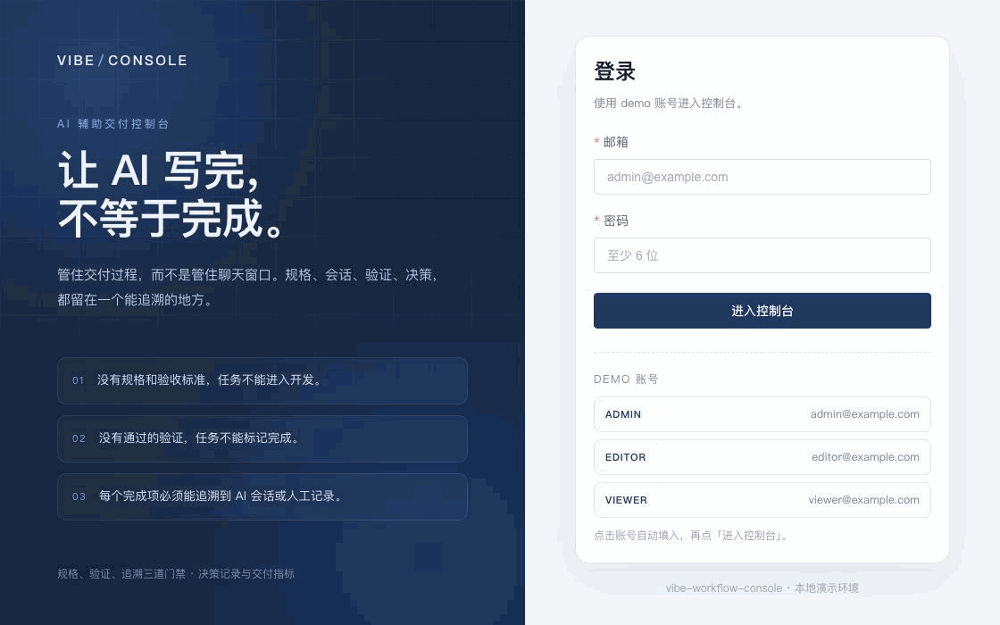
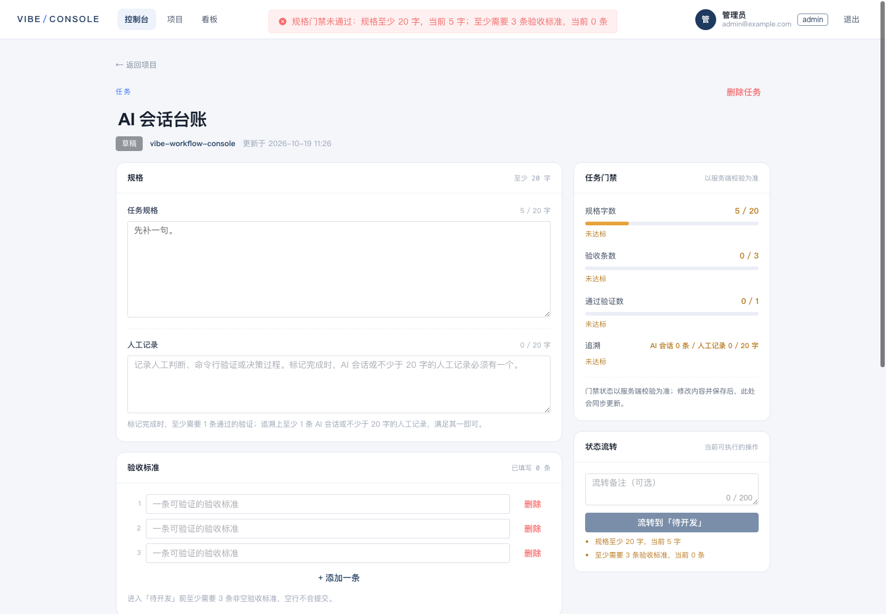
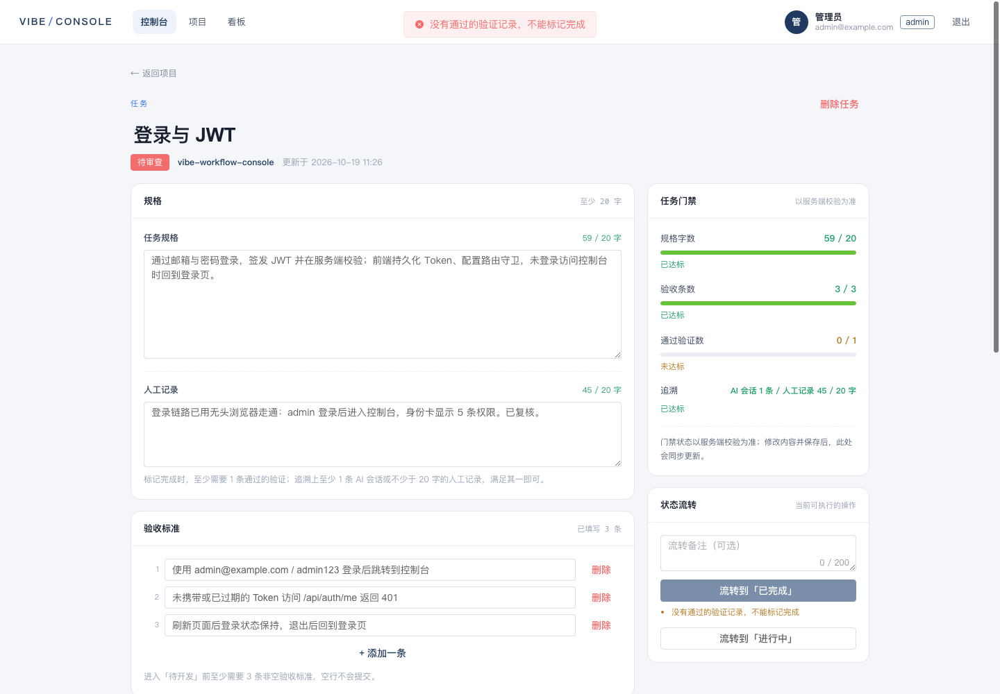
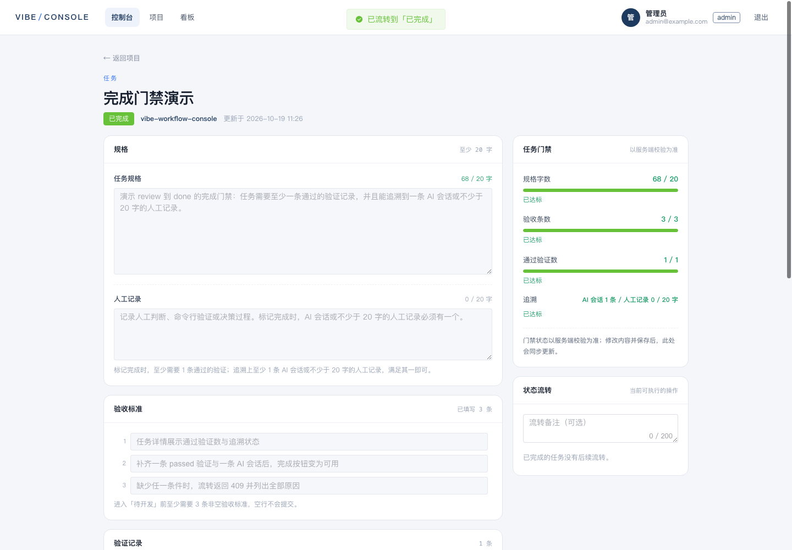
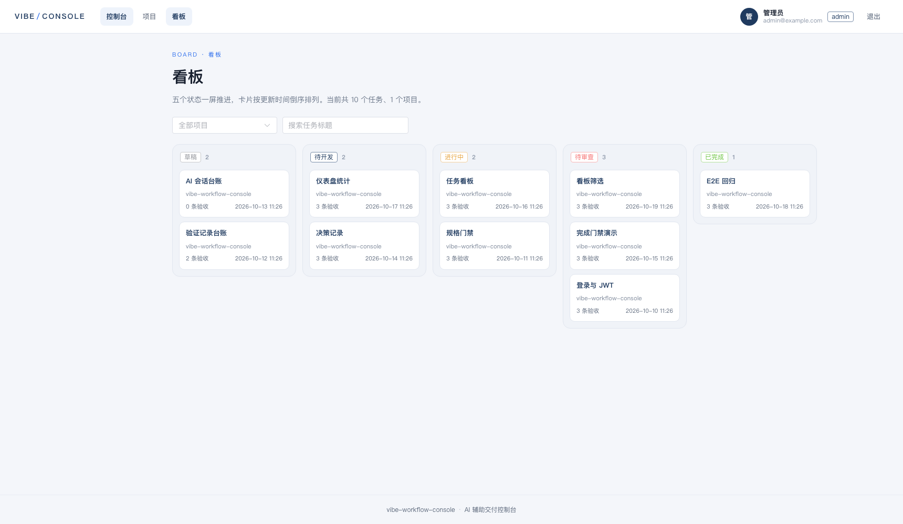
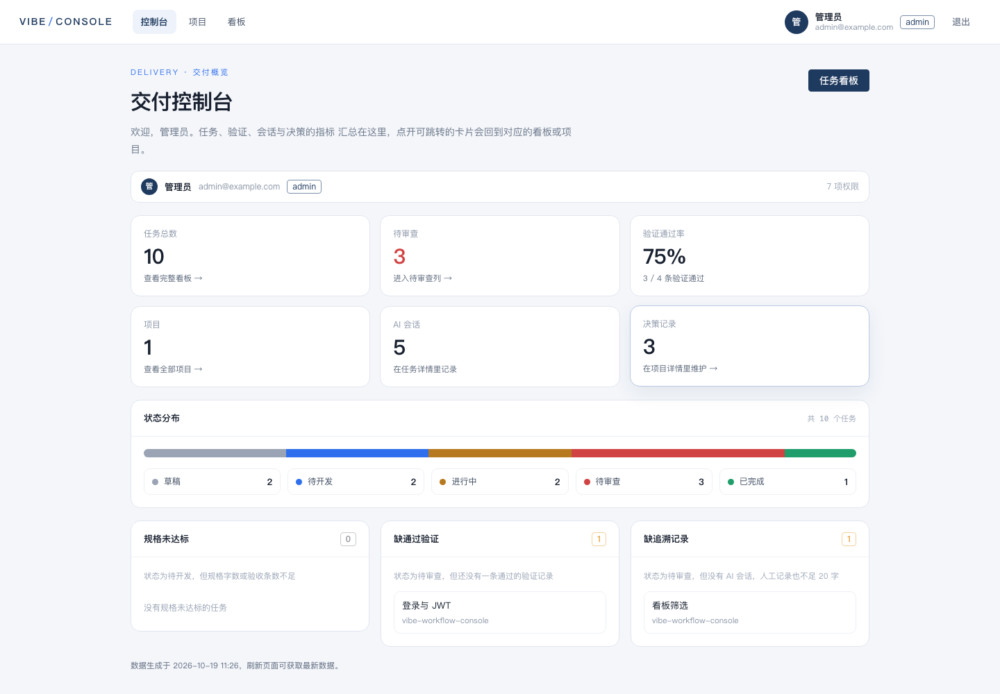

# vibe-workflow-console

**AI 辅助交付的控制台，给需要评审 AI 产出的团队。** NestJS + Prisma + Vue 3 + MySQL。三条硬规则，防止「AI 写完就算完成」。

[](https://github.com/JohnYuBabe/vibe-workflow-console/actions/workflows/ci.yml)

> 当前状态：规格、验证、追溯三道门禁，决策记录、任务看板与交付仪表盘均已可用。
> 决策可以独立记录取舍并关联任务；看板按五个状态跨项目推进；仪表盘在一屏汇总总量、状态分布、阻塞任务与验证通过率。门禁规则仍然只有 `packages/shared` 一份。

## 三条规则

1. **没有规格和验收标准，任务不能进入开发。**
2. **没有通过的验证，任务不能标记完成。**
3. **每个完成项必须能追溯到 AI 会话或人工记录。**

这不是一个聊天客户端，也不是 Agent 运行器。它管的是交付过程：规格、AI 会话、验证、决策。

## 演示

**在线地址：<https://johnyu.wancafu.com/console/>** — 演示账号 `demo@wancafu.com` / `demo-5ca5c792`（登录页也会显示）。演示数据可以随时重建，见 [deploy/README.md](deploy/README.md)。

下面这段录屏约 30 秒，是本地 Demo 数据下的真实操作：规格门禁拦下一次流转（422），验证门禁再拦下一次（409），数据满足后同一套规则放行。



[30 秒里发生了什么](docs/demo.md)

| 截图 | 说明 |
| --- | --- |
|  | 规格不足，流转返回 422 |
|  | 缺验证，完成被 409 拦下 |
|  | 门禁通过后流转到已完成 |
|  | 看板：五个状态一屏推进 |
|  | 仪表盘：总量、分布与通过率 |

## 当前能力

- **项目与任务**：项目列表、项目详情、任务列表、任务详情；项目名称、描述与仓库地址可编辑，任务标题、规格、验收标准与人工记录可编辑，任务可删除。
- **权限**：JWT 全局守卫 + `PermissionsGuard`；`@Public()` 放行登录与健康检查，其余接口默认要求登录。写接口用 `@RequirePermission` 声明权限，`viewer` 只读，`editor` / `admin` 可写。
- **规格门禁**：`draft → ready` 与 `ready → in_progress` 要求规格不少于 20 字、非空验收标准不少于 3 条，不满足返回 422。
- **验证记录**：任务可以登记执行命令、通过 / 未通过结果、证据链接与备注；记录人来自当前登录用户，删除与任务一起级联。
- **AI 会话**：任务可以关联 AI 会话（标题、工具、摘要），作为完成项的追溯依据。
- **完成门禁**：`review → done` 需要至少 1 条通过的验证，并且至少 1 条 AI 会话或不少于 20 字的人工记录。两个条件都满足时流转成功，否则返回 409 并列出全部缺口。
- **完成即定格（任务级）**：`done` 任务的更新接口整体拒绝（标题、规格、验收标准、人工记录都不能改），也不能新增 / 删除验证与 AI 会话，任务本身不可删除；校验在事务内加行锁，与并发流转互斥。该保护只覆盖任务接口：删除父项目仍会级联删除其下所有任务（包括 `done`），关联决策也仍可新增、修改或删除。
- **决策记录**：标题、背景、候选方案、决定、后果与状态（提出 / 采纳 / 取代），可关联同项目的任务；列表只返回摘要，详情返回全文。
- **任务看板**：`/board` 五列展示全部任务，卡片带所属项目，支持项目、关键词筛选；`?status=` 进入单列模式，卡片直接跳任务详情。
- **交付仪表盘**：首页汇总项目、任务、决策、AI 会话总量，五态分布，规格 / 验证 / 追溯三类阻塞任务与验证通过率（百分比），全部来自单次事务快照。
- **前端**：任务详情展示门禁面板（规格、验收、通过验证、追溯四项）和流转时间线，并提供验证记录与 AI 会话的登记、删除入口；有未保存修改时流转会先自动保存，成功后以服务端门禁为准。项目详情提供项目编辑与决策记录的增删改查。只读账号与已完成任务看不到写入入口。

## 状态与门禁

```
draft → ready → in_progress → review → done
          ↓         ↓             ↓
        draft     ready       in_progress
```

向下箭头是允许的回退；`done` 没有出边。

| 流转 | 检查 | 失败响应 |
| --- | --- | --- |
| `draft → ready`、`ready → in_progress` | 规格去空白后 ≥20 字，非空验收标准 ≥3 条 | 422 `SPEC_GATE` |
| `review → done` | 至少 1 条通过的验证记录（`result=passed`） | 409 `VERIFICATION_GATE` |
| `review → done` | 至少 1 条 AI 会话，或 `manualNote` 去空白后 ≥20 字 | 409 `TRACEABILITY_GATE` |
| 未列出的流转 | 状态机不允许 | 409 `INVALID_TRANSITION` |
| `done` 后的规格 / 验收 / 验证 / 会话 / 任务删除 | 完成即定格 | 409 `TASK_IMMUTABLE` |

错误文案使用状态中文名，例如「不允许从「草稿」直接流转到「已完成」」。`TASK_IMMUTABLE` 的 body 形如 `{ message, code, reasons }`，前端直接展示服务端文案。

## 技术栈

- Web：Vue 3 + TypeScript + Vite + Element Plus + Pinia
- Server：NestJS + Prisma
- DB：MySQL 8
- Deploy：Docker Compose + Nginx

## 本地启动

前置：Node 20+、pnpm 8+、Docker。

```bash
cp .env.example .env

# 1. 起 MySQL（宿主机端口 3308，避免和本地 3306/3307 冲突）
pnpm db:up

# 2. 安装依赖
pnpm install

# 3. 建表 + 种子数据
pnpm db:migrate
pnpm db:seed

# 4. 起前后端
pnpm dev
```

- Web：http://localhost:5173
- API：http://localhost:3010/api
- 健康检查：http://localhost:3010/api/health

### Demo 账号

以下账号只由 `pnpm db:seed` 在**本地/CI**创建：

| 角色 | 邮箱 | 密码 |
| --- | --- | --- |
| admin | admin@example.com | admin123 |
| editor | editor@example.com | editor123 |
| viewer | viewer@example.com | viewer123 |

生产环境不会写入这些账号：`NODE_ENV=production` 时 seed 改为读取
`ADMIN_EMAIL` / `ADMIN_PASSWORD` / `DEMO_EMAIL` / `DEMO_PASSWORD`，
且必须显式设置 `SEED_ON_START=true` 与 `ALLOW_DEMO_SEED=true` 才会执行。
线上登录页只显示构建时注入的公开 demo 账号（`VITE_DEMO_EMAIL` / `VITE_DEMO_PASSWORD`）。
部署步骤见 `deploy/README.md`。

### Demo 项目

`pnpm db:seed` 会**清空全部项目**，再重建项目 `vibe-workflow-console`，可重复执行（连续执行两次结果一致：1 个项目、10 个任务、3 条决策、5 条 AI 会话、4 条验证记录）。演示实例只用来放演示数据，请勿在有真实数据的库上运行。它包含 10 个任务：

- 「登录与 JWT」（待审查）规格齐全，带 1 条未通过验证与 1 条 AI 会话：追溯已满足，验证不通过仍会被 409 拦下；
- 「规格门禁」（进行中）、「任务看板」（进行中）规格与验收标准齐全，并带有流转历史；
- 「验证记录台账」只有 2 条验收标准，「AI 会话台账」规格为空，用来复现 422；
- 「决策记录」「仪表盘统计」都在待开发，规格与验收标准齐全；
- 「完成门禁演示」（待审查）带 1 条通过验证与 1 条 AI 会话，用来演示 `review → done` 可以达成；
- 「E2E 回归」（已完成）走完全部状态，验证记录如实备注「没有 E2E 用例」；
- 「看板筛选」（待审查）有通过验证但人工记录不足 20 字，用来演示追溯门禁仍然阻塞。

3 条决策分别覆盖：门禁逻辑放在 `packages/shared`（已采纳）、状态流转用事务内条件写（已采纳）、E2E 不引入 supertest（提出中），均可关联到对应任务。

## API

Base URL：`/api`。除登录与健康检查外都需要 `Authorization: Bearer <jwt>`；标注了权限的接口还要求对应权限，无权限返回 403。

| 方法 | 路径 | 权限 | 说明 |
| --- | --- | --- | --- |
| POST | `/auth/login` | 公开 | 登录，返回 JWT 与用户权限 |
| GET | `/auth/me` | 登录 | 当前用户与权限 |
| GET | `/health` | 公开 | 服务与数据库探活 |
| GET | `/projects` | `project:read` | 项目列表，含任务数与各状态计数 |
| POST | `/projects` | `project:write` | 新建项目，owner 为当前用户 |
| GET | `/projects/:id` | `project:read` | 项目详情与任务列表 |
| PATCH | `/projects/:id` | `project:write` | 修改项目 |
| DELETE | `/projects/:id` | `project:write` | 删除项目（级联任务） |
| POST | `/projects/:id/tasks` | `task:write` | 新建任务，可同时写验收标准 |
| GET | `/tasks?projectId=&status=` | `task:read` | 任务列表，可按项目与状态筛选；每条带所属项目 |
| GET | `/tasks/:id` | `task:read` | 任务详情，含门禁与可用流转 |
| PATCH | `/tasks/:id` | `task:write` | 修改标题、规格、人工记录 |
| DELETE | `/tasks/:id` | `task:write` | 删除任务（级联验收、验证、会话与流转）；done 任务返回 409 |
| PUT | `/tasks/:id/criteria` | `task:write` | 按顺序重写验收标准 |
| POST | `/tasks/:id/transitions` | `task:write` | 状态流转，门禁失败返回 422 / 409 |
| POST | `/tasks/:id/verifications` | `task:write` | 新增验证记录（命令、结果、证据链接、备注） |
| GET | `/tasks/:id/verifications` | `task:read` | 验证记录列表，按时间倒序 |
| DELETE | `/tasks/:id/verifications/:verificationId` | `task:write` | 删除验证记录；不属于该任务返回 404 |
| POST | `/tasks/:id/ai-sessions` | `task:write` | 新增 AI 会话（标题、工具、摘要） |
| GET | `/tasks/:id/ai-sessions` | `task:read` | AI 会话列表，按时间倒序 |
| DELETE | `/tasks/:id/ai-sessions/:sessionId` | `task:write` | 删除 AI 会话；不属于该任务返回 404 |
| POST | `/projects/:projectId/decisions` | `decision:write` | 新建决策；`taskId` 必须属于该项目 |
| GET | `/decisions?projectId=&taskId=&status=&limit=` | `decision:read` | 决策摘要列表，默认 100 条，上限 200 |
| GET | `/decisions/:id` | `decision:read` | 决策详情，含背景、候选方案、决定、后果全文 |
| PATCH | `/decisions/:id` | `decision:write` | 修改决策；`taskId: ''` 解除关联 |
| DELETE | `/decisions/:id` | `decision:write` | 删除决策，成功 204 |
| GET | `/dashboard/summary` | `task:read` | 交付汇总：总量、状态分布、阻塞任务、验证通过率 |

任务详情的 `availableTransitions` 给出每个候选状态是否可用及原因，`gate` 给出规格字数、验收条数、通过验证数与追溯状态；字段明细与错误响应见 [docs/day2.md](docs/day2.md)，Day 3 的验证记录与 AI 会话见 [docs/day3.md](docs/day3.md)，Day 4 的决策、看板与仪表盘见 [docs/day4.md](docs/day4.md)。

## 一键容器启动

```bash
cp .env.example .env
# 先把 .env 里的 CHANGE_ME_* 换成真实值，否则 server 会按生产规则拒绝启动：
#   MYSQL_ROOT_PASSWORD / MYSQL_PASSWORD / JWT_SECRET（≥32 位）
#   ADMIN_PASSWORD（≥16 位）/ DEMO_PASSWORD（≥12 位，若要演示数据）
openssl rand -hex 24
docker compose --profile web up --build
```

- Web：http://localhost:8080
- API：http://localhost:3010/api

容器启动时自动执行 `prisma migrate deploy`。Compose 默认不写演示数据（`SEED_ON_START=false`、`ALLOW_DEMO_SEED=false`）；要生成 Demo 账号与 Demo 项目，把这两项都改成 `true` 后重启 server。

## 域名部署

[docs 里的 Nginx 模板](deploy/nginx.conf) 按 `https://johnyu.wancafu.com/console/` 子路径部署：构建时设置 `VITE_BASE=/console/`、`VITE_API_BASE=/console/api`，静态文件放到 `/var/www/console/`，API 反向代理到本机 3010。

## 目录

```
apps/
  server/        NestJS API
  web/           Vue 3 前端
packages/
  shared/        前后端共享类型与门禁规则
docs/
  architecture.md  架构图、数据模型、取舍与已知缺口
  adr/             8 条决策记录
  demo.md          录屏分镜与复现步骤
  demo.gif         约 28 秒演示
  screenshots/     五张关键界面截图
  api-contract.md
  day1.md
  day2.md
  day3.md
  day4.md
deploy/
  nginx.conf     域名路径部署模板
```

## 测试

```bash
pnpm test
pnpm --filter @vibe/server test
pnpm --filter @vibe/server test:e2e
pnpm --filter @vibe/web lint
```

`test:e2e` 需要可用的 MySQL；CI 里由独立的 e2e job 起 `mysql:8` 服务，先 `prisma migrate deploy` 与 seed，再串行执行。

## 文档

- [API 契约](docs/api-contract.md)
- [架构](docs/architecture.md)
- [决策记录（ADR）](docs/adr/)
- [Day 1 交付说明](docs/day1.md)
- [Day 2 交付说明](docs/day2.md)
- [Day 3 交付说明](docs/day3.md)
- [Day 4 交付说明](docs/day4.md)

## License

MIT
