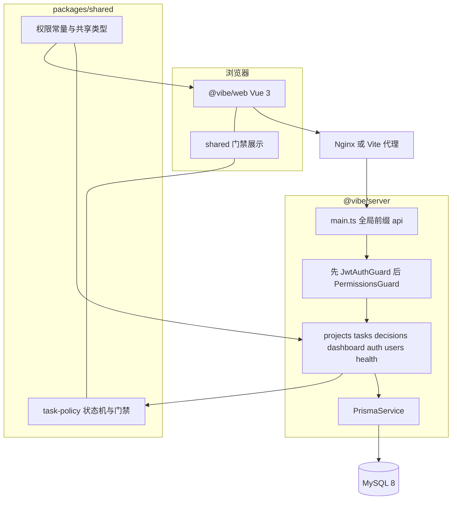
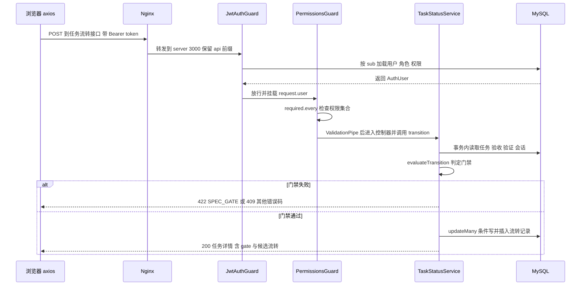
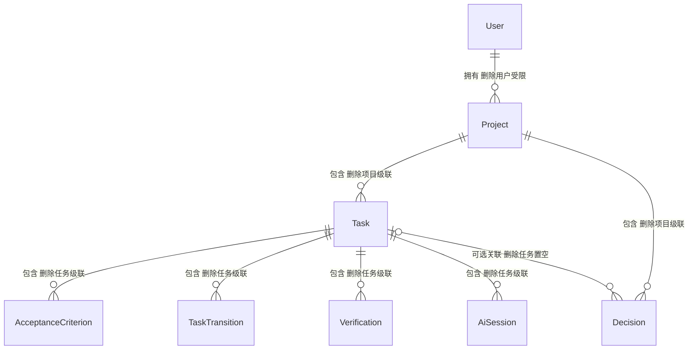
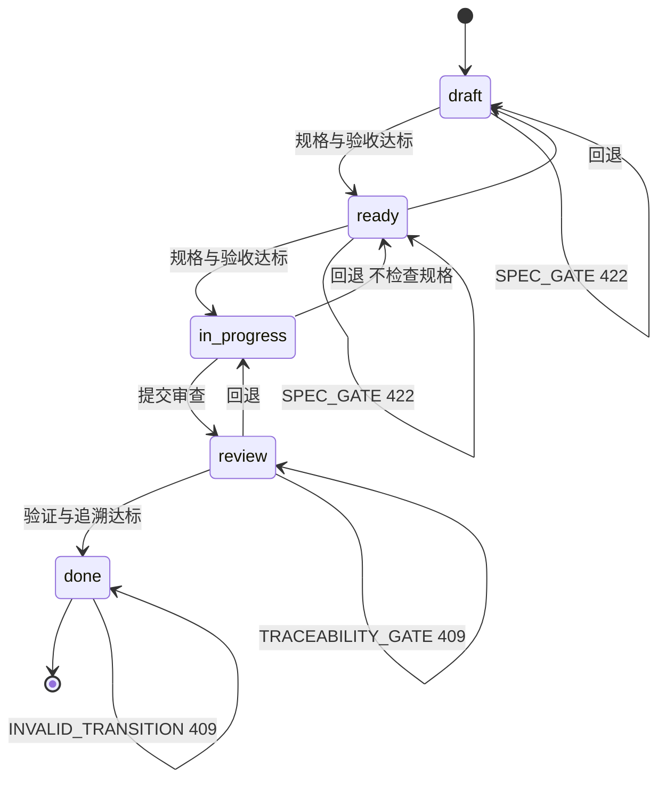

# 架构说明

这个系统解决的问题是：把 AI 辅助写代码的过程放进一条可检查的交付链路，让规格、验收、验证、追溯在任务流转时被强制检查。它只负责记录和拦截，不调用模型、不运行任务，所以不是聊天客户端，也不是 Agent 运行器。边界是单工作区、演示数据、无多租户；多人隔离与组织级权限尚未实现。

## 1. 工作区与技术栈
`pnpm-workspace.yaml` 声明 `apps/*` 与 `packages/*`。`@vibe/server` 用 NestJS 11.2.7、Prisma 6.19.3 与 MySQL；`@vibe/web` 用 Vue 3.5.44、Vite 7.3.7、Element Plus、Pinia；`@vibe/shared` 无运行时依赖，只编译 TypeScript。
后两者通过 `workspace:*` 依赖 shared；根 `package.json` 的构建顺序固定为 shared → server → web，`dev` 用 `pnpm -r --parallel dev`。

## 2. 模块关系

后端没有 repository 层，service 直接使用 `PrismaService`。门禁判断放在 `packages/shared/src/task-policy.ts` 的纯函数里，只在 server 侧调用；web 从 shared 引入阈值常量与类型，展示接口返回的 `gate` 与 `availableTransitions`，不重算规则。

## 3. 一次带鉴权请求

- 权限每次请求从数据库读取，`JwtStrategy.validate` 按 `sub` 查用户并 include `roles → role → permissions`，没有缓存。
- 两个守卫按 `app.module.ts` 中 `APP_GUARD` 的注册顺序执行，代码注释要求先 Jwt 后 Permissions。
- 流转在事务内先判定门禁，再用 `updateMany({ id, status: 原状态 })` 条件写；`count === 0` 返回 409，避免并发写出矛盾历史。

## 4. 数据模型

业务实体主键统一 `String @id @default(cuid())`；两张关联表 `user_roles` 与 `role_permissions` 用复合主键 `@@id([...])`。表名用 `@@map` 转下划线，字段细节见 `apps/server/prisma/schema.prisma`。角色权限的多对多关系图中省略。

- 删项目级联删任务与决策；删任务级联删验收标准、流转、验证、AI 会话，关联决策保留并把 `taskId` 置空。
- 删用户级联删 `user_roles`；验证、会话、决策的记录人 `SetNull`；该用户拥有的项目和作为 actor 的流转记录是 `RESTRICT`，会阻止删除。

## 5. 状态机与门禁

| 流转 | 条件 | 失败结果 |
| --- | --- | --- |
| `draft → ready`、`ready → in_progress` | 规格 trim 后 ≥20 字；非空验收标准 ≥3 条 | 422 `SPEC_GATE` |
| `review → done` | `result='passed'` 的验证 ≥1 条 | 409 `VERIFICATION_GATE` |
| `review → done` | AI 会话 ≥1 条，或人工记录 trim 后 ≥20 字 | 409 `TRACEABILITY_GATE` |
| 未列出的有向边 | 状态机不允许 | 409 `INVALID_TRANSITION` |
| `done` 任务上的修改与删除 | 事务内 `SELECT ... FOR UPDATE` 锁行 | 409 `TASK_IMMUTABLE` |

阈值来自 `packages/shared/src/task-policy.ts`：`SPEC_MIN_LENGTH = 20`、`ACCEPTANCE_MIN_COUNT = 3`、`MANUAL_NOTE_MIN_LENGTH = 20`。`in_progress → ready` 是回退，不检查规格；`review → done` 同时检查验证与追溯，`code` 取第一条失败门禁，`reasons` 包含全部原因。
`done` 没有出边，任何流转请求都走 `INVALID_TRANSITION`；`TASK_IMMUTABLE` 只由修改与删除接口的 `assertTaskMutable` 抛出，不是流转错误码。`done` 不可变只覆盖任务本身、规格、验收标准、人工记录、验证、AI 会话与任务删除；决策服务不调用 `assertTaskMutable`，done 任务仍可新增或修改关联决策。图中自环表示请求被拒绝、状态不变。

## 6. 关键取舍
- 门禁只写一份并且用事务条件写：shared 同时被 server 与 web 引用，展示与拦截不会出现两套口径；流转时门禁读取、状态更新、历史记录在同一事务，并发请求只有一个成功。
- done 写保护用行锁：完成门禁只在流转瞬间判定，完成后若能删证据，任务会停在 done 但不再达标。
- 决策列表只取摘要：正文列可能很长，列表与任务详情卡片不需要，详情与写接口才返回全文。
- 仪表盘单事务快照：一次读取计数与门禁字段，避免多个数字来自不同时刻。

## 7. 没有做什么，以及为什么
| 缺口 | 现状 |
| --- | --- |
| 多租户 | schema 没有 tenant/org/workspace 字段，所有查询都无租户过滤，系统是单一隐含工作区 |
| 对象级授权 | 只有 `@RequirePermission()` 资源级校验；`ownerId` 只记录不参与鉴权，任何 `project:write` 账号可改删任意项目 |
| 分页 | `GET /projects`、`GET /tasks`、验证列表、AI 会话列表全量返回；只有 `GET /decisions` 有 `limit`，默认 100 上限 200，无 offset 或 cursor |
| 刷新令牌 | 只有单个 `accessToken`，默认 12 小时；没有 refresh token 表、刷新接口、撤销接口，退出登录只是前端删 `localStorage` |
| 结构化日志 | 没有 Logger 配置、拦截器、异常过滤器、request id 或 OpenTelemetry；只有启动时 `console.log` 和 entrypoint 的 `echo` |
| 限流与生产默认值 | 已有 `@nestjs/throttler`（全局 120/分钟、登录 10/分钟）与 Helmet；CORS 默认关闭，只有配置 `CORS_ORIGINS` 才放行；Compose 不提供任何默认密钥，生产缺 `DATABASE_URL` 或弱 `JWT_SECRET` 直接拒绝启动；server 镜像以 `node` 非 root 运行。仍没有 CSRF token，靠 Bearer token 与同源部署规避 |
| Web 测试 | `apps/web` 的 `test` 仍是 `echo "no tests yet"`；E2E 只打 API，不驱动浏览器；server 的 `test` 带 `--passWithNoTests` |

还有几项明确未建：用户管理接口、任务拖拽重排、附件上传、审计日志导出、OpenAPI/Swagger、自动化部署。CI 的 `docker` job 构建镜像并检查运行用户，`smoke` job 用 MySQL service 起容器，打 `/api/health`、登录、未授权 401 与限流。

## 8. 后续演进顺序
1. **部署闭环（已完成，2026-10）**：生产显式注入强 `JWT_SECRET`、默认不 seed、容器非 root、CI 起容器体检、HTTPS 上线 `https://johnyu.wancafu.com/console/`。剩余的是把手工 rsync 换成自动化部署。
2. **访问控制**：先收紧 CORS 与限流，再决定是补对象级授权，还是把「单工作区」写成明确产品定位。当前模型无法直接支持多人隔离。
3. **可观测性**：加 request id 与结构化日志，把 4xx/5xx、门禁失败码、慢查询打成可检索字段。现在排障只有一条启动日志。
4. **数据量与前端质量**：给任务、项目、验证、会话补分页或服务端筛选，同时补 web 端测试并去掉 `--passWithNoTests`。看板目前依赖全量任务做客户端筛选。
